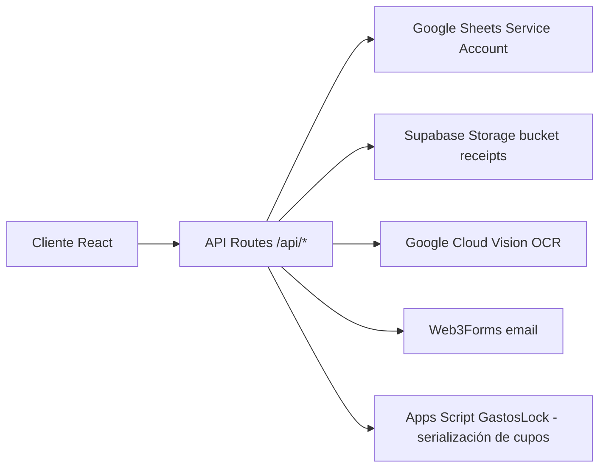

# CURRENT.md — GastosNX / RindeNX

> **Fuente de verdad del estado actual del proyecto.**
> Este documento debe mantenerse sincronizado con cualquier cambio estructural. Léelo antes de modificar código.
> La guía de despliegue del lock vive en `docs/DEPLOY_GAS_LOCK.md` y las decisiones en `docs/DECISIONS.md` (última: ADR-014).

**Última actualización:** 2026-10-14

---

## 1. Resumen del proyecto

**GastosNX** (versión `1.0.0`) es una aplicación web chilena para registrar, respaldar y categorizar **gastos operacionales menores** (peajes, estacionamientos, colaciones, combustibles, etc.) destinada a pymes y contadores en Chile.

Propósito principal: capturar el respaldo de un gasto antes de que se pierda, ordenarlo y dejarlo listo para la Declaración de Renta anual (compatible con requisitos SII). **No determina deducibilidad tributaria** — solo respaldo y orden documental.

**Marca / URL:** gastos.nxchile.com · Autor: NXChile · Contacto: gastos@nxchile.com
> ℹ️ **Marca (2026-08-10):** la interfaz fue unificada de **"GastosSII"** → **"GastosNX"** (navbar, footers, textos y emails). El logotipo oficial es `public/images/LogogastosNX.png` (693×138, usado con `width={693}`/`height={138}` y clases `h-* w-auto object-contain`).

### RindeNX (sistema independiente, en desarrollo)

> ⚠️ **Coexistencia:** RindeNX es un **sistema independiente** que coexiste con GastosNX en el mismo repositorio. Ambos productos tienen dashboards separados, datos independientes y un **puente opcional** que permite aprovechar ciertos documentos de rendiciones en la línea de Gastos.

- **Subdominio:** `rinde.nxchile.com` (mismo deploy que `gastos.nxchile.com`, enrutado por `src/proxy.ts`). **Desplegado y verificado (2026-09-08):** dominio agregado en Vercel, DNS en Cloudflare (`CNAME rinde → expense-tracker-nxchile.vercel.app`) propagado y `COOKIE_DOMAIN=.nxchile.com` configurado. Detalles en `DEPLOY.md` §2.1.
- **Landing pública:** `src/app/rinde-landing/` (ruta `/rinde-landing`, pública sin auth; en `rinde.nxchile.com` es la raíz vía proxy). Paleta ámbar/naranja (RindeNX). Secciones: Hero+CTA demo, Prueba social (logos), "¿Tu empresa todavía funciona así?" (pain points), Cómo funciona (timeline 7 pasos), Demo visual (2 cards de fondo), Beneficios (fondo completo controlado), RindeNX+GastosNX (ecosistema), Testimonios (Antes→Resultado), CTA final (demo+WhatsApp). Contacto: `rinde@nxchile.com`.
- **Página de precios:** `src/app/precios/` (ruta `/precios`, pública sin auth). SEO optimizado (title, meta description, OG, structured data SoftwareApplication/Organization/FAQPage/BreadcrumbList). Selector mensual/anual, 4 planes (Pyme $9.900/$12.900, Empresa $19.900/$24.900, Pro $34.900/$44.900, +30 cotizar), flujos visuales (fondo→contabilidad, admin→rendidor→contabilidad, RindeNX→GastosNX), beneficios, sectores, FAQ 9 preguntas, CTA demo/WhatsApp.
- **SSO entre subdominios:** la cookie `gx_session` acepta `domain` vía la variable `COOKIE_DOMAIN` (p.ej. `.nxchile.com`). En localhost debe quedar vacía. Con el mismo deploy + `AUTH_SECRET`, login en un subdominio vale para ambos.
- **Funcionalidad:** Manejo de rendiciones de fondos fijos, gastos de personal, revisión/aprobación por admin, generación de asiento contable.
- **Asignación de fondos:** El admin asigna un monto + observación/glosa a un usuario, quien rinde contra ese fondo.
- **Puente (Fase 5):** RindeNX → GastosNX (dirección única). Solo aplica a empresas con `gastos_activo=TRUE` en la hoja `Config_Rinde` del spreadsheet.
- **Usuarios afectados por el puente:** solo `tipo_usuario: ambos` y empresas que también usan GastosNX.
- **NO comparte tablas con GastosNX:** cada cliente tiene su propio spreadsheet que contiene tanto la línea de Gastos como la de RindeNX.

---

## 2. Estado de producción (2026-10-14)

| Componente | Estado |
|---|---|
| Deploy GastosNX / RindeNX | `gastos.nxchile.com` y `rinde.nxchile.com` → HTTP 200; `/api/auth/me` → 401 sin sesión (API viva) |
| Rama | `origin/main` = `cc96ab1` |
| Control de cupos (lock Apps Script) | **Desplegado y operativo** (confirmado por el owner); `GAS_LOCK_URL` / `GAS_LOCK_SECRET` configuradas en Vercel Production |
| Migración de esquema `Gastos` A:L → A:N | **Ejecutada y verificada** (auditoría de solo lectura 2026-10-14: `idempotency_key`=M y `estado`=N presentes en las 4 hojas de empresa) |
| Respaldo pre-migración | ZIP local verificado (5 documentos, 12 pestañas, 348 registros) + carpeta Drive `RESPALDO_PRE_MIGRACION_2026-10-13` (compartida; la subida de archivos quedó bloqueada por cuota de Service Account) |
| Alta de usuarios por admin | Corregida (commit `cc96ab1`) |
| Indicador de plan tras guardar | Corregido (commit `0e31c6a`) |

**Verificación formal recomendada (no bloqueante):** ejecutar las pruebas desplegadas de concurrencia e idempotencia de `docs/DEPLOY_GAS_LOCK.md` §8 contra el endpoint publicado.

---

## 3. Plan de 8 Fases del Proyecto

| # | Fase | Estado | Descripción |
|---|------|--------|-------------|
| 1 | Identificación de usuario | ✅ Completada | Campo `tipo_usuario` agregado a la hoja Users (columna K). Valores: `gastos`, `rinde`, `ambos`. |
| 2 | Dashboard super-admin con navegación | ✅ Completada | Autenticación contra Google Sheets, layout con navbar, logout, listado de fases. |
| 3 | Gestión de usuarios en la hoja Users | ✅ Completada | CRUD de usuarios desde el super-admin (`/super-admin/usuarios`) con filtros, modal de edición y modal de creación. |
| 4 | Gestión de empresas (hoja Config) | ✅ Completada | CRUD de empresas desde el super-admin (`/super-admin/empresas`) con validación de email/subdomain/sheet_id. |
| 5 | Puente GastosNX + RindeNX | ✅ Completada | Integración unidireccional RindeNX → GastosNX con selección manual de gastos al aprobar rendición. Solo `boleta` y `voucher` pasan (las `factura` no). |
| 6 | RindeNX - Fondos y asientos | ✅ Completada | Spreadsheet RindeNX con 7 hojas (Rendiciones, GastosRinde, Asientos, Puente, Fondos, Config_Rinde + Gastos), dashboard, rendiciones, gastos, aprobación, asiento contable. |
| 7 | RindeNX - Puente de documentos | ✅ Completada | Vista `/rinde/puente` con tabla de documentos traspasados, filtros y sección en detalle de rendición mostrando los gastos pasados. |
| 8 | Documentación y despliegue | ✅ Completada | Actualización de `CURRENT.md` y `DECISIONS.md`, guía de pruebas locales, guía de despliegue de `rinde.nxchile.com`. Despliegue verificado y funcionando (2026-09-08). |

### Extensiones post-Fase 8 (resumen)

- Hoja `Fondos` (asignación por admin) y vinculación rendición ↔ fondo (`fondo_id` col K; descuento de `Fondos!D` al aprobar).
- `tipo_documento` en `GastosRinde` (boleta/factura/voucher/sin_comprobante) y asiento separado por tipo.
- Herencia de plan/boletas/empresa al crear usuarios desde el admin (ADR-003).
- **Bug login corregido (2026-09-03):** la hoja Usuarios se leía solo hasta J, por lo que `tipo_usuario` (K) nunca llegaba a la sesión. Ampliado a `A2:K100`; `rinde` → `/rinde`, `ambos` → GastosNX + botón RindeNX, `gastos` bloqueado de `/rinde`.
- Dashboard RindeNX rediseñado (Fondos en Curso / Rendiciones; puente oculto para no-admin).

---

## 4. Stack tecnológico

| Área | Tecnología |
|------|-----------|
| Framework | **Next.js 16.2.4** (App Router) |
| UI / React | **React 19.2.4** |
| Lenguaje | TypeScript 5 (strict) |
| Estilos | Tailwind CSS 4 + PostCSS + autoprefixer |
| Íconos | lucide-react |
| Utilidades CSS | clsx + tailwind-merge (`cn`) |
| PWA | @ducanh2912/next-pwa + workbox-webpack-plugin |
| Google Sheets | googleapis (`google.sheets`) |
| Storage de imágenes | @supabase/supabase-js (bucket `receipts`) |
| OCR | **Google Cloud Vision API** (`/api/ocr`) |
| Envío de emails | Web3Forms (`api.web3forms.com/submit`) |
| Control de cupos | Google Apps Script (`LockService`) — `google-apps-script/GastosLock.gs` |

Scripts: `dev` (next dev) · `build` (next build) · `start` (next start) · `test` (node --test) · `lint` (eslint).

---

## 5. Arquitectura general

> **Regla clave:** NO existe base de datos relacional propia. La **fuente de verdad de datos es Google Sheets**, vía Service Account. Supabase se usa **solo para almacenar imágenes** (no tablas de negocio).

Flujo de datos de alto nivel:



### Almacenamiento de datos (Google Sheets)

1. **Hoja de Configuración/Usuarios** (`GOOGLE_CONFIG_SHEET_ID`):
   - Hoja **Usuarios** — columnas `A:K` (ver §7).
   - Hoja de empresas/maestra — columnas `A:E` para configuración por subdominio (leída por `lib/companyConfig.ts`).
2. **Spreadsheet de gastos por empresa** (`sheet_id_asociado` de cada fila de Usuario):
   - Hoja **Gastos** — columnas `A:N` (ver §7).
   - Hojas RindeNX: `Rendiciones`, `GastosRinde`, `Asientos`, `Puente`, `Fondos`, `Config_Rinde`.

---

## 6. Estructura de carpetas

```
src/
  app/
    page.tsx                       Landing pública GastosNX (marketing, flujos visuales)
    rinde-landing/page.tsx         Landing pública RindeNX (ámbar; ruta /rinde-landing)
    rinde-landing/layout.tsx       Metadata/OG propios de la landing RindeNX
    precios/                       Página de precios (server SEO + client selector/FAQ)
    captura/page.tsx               Flujo captura → OCR → revisión → guardado
    dashboard/page.tsx             Dashboard usuario/empresa (stats + gastos + desglose)
    login/page.tsx                 Login + modales recuperación/contacto
    manual/page.tsx                Manual de uso con video
    reset-password/page.tsx        Recuperación autoservicio (token HMAC)
    mi-cuenta/                     Cambio de contraseña con sesión
    registro/{page,free,pago,confirmacion}/   Alta de usuarios (Free / Pro)
    admin/
      page.tsx                     Panel admin: gestión de usuarios (hereda empresa/plan)
      generador-hash/page.tsx      Generador de hash de contraseñas
      reset-password/page.tsx      Reset de contraseña manual
    super-admin/{usuarios,empresas,stats,auth}/   Gestión global (rol superadmin)
    rinde/                         Módulo RindeNX (layout con auth guard)
      page.tsx / dashboard-client.tsx           Dashboard RindeNX
      puente/{page,puente-client}.tsx           Documentos traspasados
      fondos/{page,fondos-client}.tsx           Asignación de fondos
      rendiciones/[id]/{page,detalle-client,nuevo-gasto}/  Detalle y alta de gasto
    api/
      auth/route.ts                POST login (valida contra Usuarios)
      auth/me/route.ts             GET sesión desde cookie; reconcilia cupo/límite cada 5 min y renueva cookie
      auth/logout/route.ts         POST logout
      auth/reset-request/          POST solicita recuperación (token HMAC)
      auth/reset-confirm/          POST confirma recuperación
      auth/change-password/        POST cambio con sesión iniciada
      expenses/route.ts            GET gastos (filtra por rol)
      save-expense/route.ts        POST guardado bajo bloqueo: valida cupo, registra fila con idempotency_key y renueva cookie
      export/route.ts              GET CSV de gastos
      ocr/route.ts                 POST Google Cloud Vision OCR
      get-company-config/route.ts  GET config por subdominio
      health/route.ts              GET health check Supabase
      admin/users/route.ts         CRUD usuarios (solo admin; hereda empresa/plan; escribe tipo_usuario en K)
      admin/stats/route.ts         GET estadísticas de empresa
      admin/create-user-sheet/     Util: crea hoja Usuarios + admin por defecto
      rinde/rendiciones/route.ts   GET/POST rendiciones
      rinde/rendiciones/[id]/      GET/PATCH rendición (+asiento)
      rinde/gastos/route.ts        POST gastos Rinde (con tipo_documento)
      rinde/puente/route.ts        GET/POST puente (saveBatch bajo bloqueo, idempotente)
      rinde/puente/documentos/     GET documentos del puente
      rinde/fondos/route.ts        GET/POST fondos
      rinde/fondos/[id]/route.ts   PATCH/DELETE fondo
    layout.tsx / globals.css       Root layout (SEO, PWA, SupportButton)
  proxy.ts                         Proxy de subdominios: rinde.* → RindeNX (Next 16)
  components/
    CameraCapture.tsx · OcrProcessor.tsx · ExpenseForm.tsx · DashboardStats.tsx
    LoginForm.tsx · SupportButton.tsx · ui/{Button,Card,Input,Badge,Alert}
  lib/
    auth.ts                        Cliente sesión (loadSession/getSession)
    session.ts                     JWT HS256 + cookie httpOnly (ADR-002); readSessionMeta expone iat
    password.ts                    Hash con sal `sha256:<salt>:<hash>` + verifyPassword (legacy → rehash al login, ADR-001)
    password-utils.ts              Generar/verificar contraseñas
    sheets.ts                      getSheets(readOnly?) — cliente central de Google Sheets (ADR-004)
    storage.ts                     Subida/borrado imagen a Supabase Storage
    ocr.ts                         Cliente OCR (tolera confidence null)
    parser.ts                      Parser de boleta chilena (compartido GastosNX/RindeNX)
    companyConfig.ts               Config por subdominio
    domains.ts                     URLs absolutas entre productos (GASTOS_DASHBOARD / RINDE_DASHBOARD)
    gastos-cuenta.ts               countExpensesOfUser: consumo derivado de Gastos!L:N
    gastos-lock.ts                 Cliente del script de bloqueo (mapLockStatus; fail-closed)
    puente-idempotencia.ts         Ids deterministas del puente + plan de reintento
    idempotency-cliente.ts         Política de idempotency_key en el cliente (captura)
    sesion-contadores.ts           Renovación de contadores de sesión tras guardar
    admin-usuarios.ts              Payload de alta de usuario (empresa/plan heredados al enviar)
    rinde-helpers.ts               SpreadsheetId Rinde + asiento contable
    utils.ts                       cn() helpers
```

---

## 7. Esquema de datos (Google Sheets)

### Hoja **Usuarios** (config maestra, columnas `A:K`)
| Índice | Columna | Descripción |
|--------|---------|-------------|
| 0 | `email` | Email del usuario (único) |
| 1 | `password_hash` | `sha256:<salt>:<hash>` (ADR-001); legacy SHA-256 sin sal se rehashea en su próximo login |
| 2 | `empresa_nombre` | Nombre de la empresa |
| 3 | `plan` | `free` / `pro` / `enterprise` |
| 4 | `limite_boletas` | Límite del plan — **fuente autoritativa del cupo**, leída dentro del bloqueo |
| 5 | `boletas_usadas` | **Informativo.** El consumo real se deriva de `Gastos` (ver §8) |
| 6 | `activo` | `TRUE` / `FALSE` |
| 7 | `rol` | `admin` / `user` / `superadmin` |
| 8 | `creado_en` | Timestamp ISO de creación |
| 9 | `sheet_id_asociado` | Spreadsheet de la empresa (contiene Gastos y RindeNX) |
| 10 | `tipo_usuario` | `gastos` / `rinde` / `ambos` (Fase 1) |

### Hoja **Gastos** (columnas `A:N`) — GastosNX
| Índice | Columna | Descripción |
|--------|---------|-------------|
| 0 | `timestamp` | Timestamp ISO de registro |
| 1 | `fecha` | Fecha del gasto (YYYY-MM-DD) |
| 2 | `rut` | RUT del proveedor |
| 3 | `proveedor` | Nombre del proveedor |
| 4 | `monto` | Monto (numérico) |
| 5 | `categoria` | Categoría |
| 6 | `boleta_numero` | N° de boleta |
| 7 | `giro` | Giro del proveedor |
| 8 | `notas` | Notas adicionales |
| 9 | `ocr_confidence` | Confianza del OCR (histórico; Vision hoy devuelve `null`) |
| 10 | `image_url` | URL de la imagen en Supabase |
| 11 | `creado_por` | Email del usuario que registró el gasto — **ancla del consumo** |
| 12 | `idempotency_key` | Clave única de la operación (ADR-014; vacía en histórico = válida) |
| 13 | `estado` | `ok` / `rechazado` (vacío = `ok`); los `rechazado` no consumen cupo |

Las columnas de control (M/N) las detecta el script **por nombre de cabecera**; si el esquema es ambiguo (fila 1 vacía, `creado_por` ausente o destino ocupado) la operación se detiene sin escribir.

### Hojas de RindeNX (mismo spreadsheet que Gastos)

#### `Rendiciones` (`A:K`)
`id`, `fecha_creacion`, `fecha_cierre`, `estado` (`abierta`/`terminada`/`en_revision`/`procesando`/`aprobada`/`rechazada`/`cerrada`), `monto_total`, `descripcion`, `usuario_email`, `aprobado_por`, `comentarios`, `asiento_id`, `fondo_id`. El estado `procesando` marca una aprobación en curso (recuperable por reintento).

#### `GastosRinde` (`A:O`)
`id`, `rendicion_id`, `fecha`, `rut`, `proveedor`, `monto`, `categoria`, `boleta_numero`, `giro`, `notas`, `image_url`, `creado_por`, `creado_en`, `pasado_a_gastos`, `tipo_documento`.

#### `Asientos` (`A:J`)
`id` (determinista por rendición: `AST-<hash>`), `rendicion_id`, `fecha`, `tipo`, `cuenta`, `debe`, `haber`, `descripcion`, `creado_por`, `creado_en`.

**Estructura del asiento (cuadrado):** Débito `Gastos operacionales – Facturas` (total facturas) y `Gastos operacionales – Boletas/Vouchers` (total boletas+vouchers); Haber `Fondo por rendir – Cuenta por cobrar empleados` (monto asignado); si rindió **menos** → Débito `Saldo por devolver del usuario`; si rindió **más** → Haber `Saldo a favor del usuario – Reembolso`. Siempre cuadra (Debe = Haber). Cuentas configurables en `Config_Rinde!E:G`. La app es un **registro operacional**, no un sistema contable. Descarga CSV/PDF y envío por correo/WhatsApp.

#### `Puente` (`A:F`)
`id` (determinista: `PTE-<hash>` por gasto; `PTE-FONDO-<hash>` marca el descuento de fondo), `rinde_gasto_id`, `rendicion_id`, `gastos_row_number`, `pasado_en`, `aprobado_por`. Solo pasan `boleta` y `voucher`; las `factura` no.

#### `Fondos` (`A:I`)
`id`, `usuario_email`, `monto_asignado`, `saldo`, `observacion`, `fecha_asignacion`, `estado` (`en_curso`/`cerrado`), `asignado_por`, `empresa`.

#### `Config_Rinde` (`A:G`)
`empresa`, `rinde_activo`, `gastos_activo` (controla el puente), `admin_email`, `cuenta_anticipo`, `cuenta_saldo_favor`, `cuenta_saldo_contra`.

### Hoja de configuración de empresas (`GOOGLE_CONFIG_SHEET_ID`, `A:E`)
`email`, `sheetId`, `empresaNombre`, `subdomain`, `activo` (ver `lib/companyConfig.ts`).

---

## 8. Control de cupos (ADR-014)

Reglas vigentes:

1. **`Usuarios!E` es la fuente autoritativa del límite.** El script la lee dentro del bloqueo; no acepta el límite del token ni tiene fallback: si no puede leerla responde `limit_unavailable` y el backend devuelve `503` reintentable, sin escribir.
2. **El consumo se deriva de los registros reales:** filas de `Gastos` con `creado_por` = usuario, excluyendo `estado='rechazado'`. `Usuarios!F` es solo informativo.
3. **Idempotencia:** cada fila lleva su `idempotency_key` en el mismo append. Un reintento con la misma clave devuelve el resultado original sin crear fila ni consumir.
4. **Serialización:** todas las operaciones que consumen cupo (`save`, `saveBatch`) pasan por `GastosLock.gs` con `LockService`. Fallo cerrado: si el script no está disponible, las rutas responden `503` y no escriben; **no existe escritura alternativa** a `Gastos`.
5. **Nunca se borra un gasto válido.** El sobrecupo potencial se neutraliza marcando `estado='rechazado'` (solo la fila propia).
6. **Puente:** transferir gastos a GastosNX (`saveBatch`) consume cupo y valida el lote completo (todo o nada); crear una rendición **no** consume por sí mismo.
7. **Lecturas controladas:** `/api/auth/me` no lee Sheets si la sesión tiene <5 min; al vencer reconcilia consumo y límite y renueva la cookie. Tras un guardado exitoso la ruta renueva la cookie con los contadores confirmados (`sesion-contadores.ts`) para que el dashboard no muestre valores previos.
8. **Contrato HTTP:** Apps Script siempre responde HTTP 200 y el resultado viaja en `status` (`ok`, `duplicate`, `quota_exceeded`, `limit_unavailable`, `lock_timeout`, `unauthorized`, `not_configured`, `schema_not_migrated`, `schema_conflict`, `partial_batch`, `write_failed`, `neutralize_failed`, `bad_request`, `unknown_action`, `script_error`). El backend decide por `status` (jamás por el código HTTP) y solo `ok`/`duplicate` confirman escritura. Detalle y procedimientos: `docs/DEPLOY_GAS_LOCK.md`.

---

## 9. Planes y límites

### Oferta pública vigente (2026-08-28)

#### Plan Free
- **$0 / mes** · 1 usuario (self-registro) · 10 boletas / mes · OCR con Google AI · Dashboard básico + Export CSV

#### Plan Pro — Pago anual (recomendado)
- **$3.300 por usuario / mes** (IVA incluido) · hasta 3 usuarios → **$9.900 / mes** · usuario adicional: **$2.500 c/u** · facturación anual · 500 boletas / mes · OCR · dashboard avanzado · Export CSV + Excel · soporte prioritario

#### Plan Pro — Pago mes a mes
- **$4.000 por usuario / mes** (IVA incluido) · hasta 3 usuarios → **$12.000 / mes** · usuario adicional: **$3.000 c/u** · sin contrato · 500 boletas / mes · mismas características

> ℹ️ **Enterprise eliminado (2026-08-28):** fuera de la oferta pública y de los flujos de registro; permanece solo en el schema interno (`PLAN_LIMITS`, `PLAN_HIERARCHY`). ✅ **ADR-003:** límites unificados — el admin hereda el plan al crear usuarios y el límite de boletas siempre viene de la constante del plan (no del cliente).

### Jerarquía de planes (admin)
`free (1) < pro (2) < enterprise (3)` — un admin solo puede crear/editar usuarios con planes iguales o inferiores al suyo (`PLAN_HIERARCHY`).

### Constantes centralizadas

| Archivo | Constante | Valores |
|---------|-----------|---------|
| `src/app/api/admin/users/route.ts` | `PLAN_LIMITS` | `{ free: { boletas: 10, usuarios: 1 }, pro: { boletas: 500, usuarios: 3 }, enterprise: { boletas: 9999, usuarios: 10 } }` |
| `src/app/api/admin/users/route.ts` | `PLAN_HIERARCHY` | `{ free: 1, pro: 2, enterprise: 3 }` |
| `src/app/admin/page.tsx` | `PLAN_LIMITS` (frontend) | `{ free: 10, pro: 500, enterprise: 9999 }` |
| `src/app/registro/pago/page.tsx` | `planes.pro` | Precios por usuario (anual $3.300, mensual $4.000) y extras ($2.500 / $3.000) |

---

## 10. Flujo de captura de gasto

1. **Captura** (`/captura`): fotografía o subida de imagen (`CameraCapture`).
2. **OCR** (`/api/ocr`): Google Cloud Vision `TEXT_DETECTION` devuelve el texto completo; confianza `null` (no se inventa porcentaje; ADR-005).
3. **Parseo** (`lib/parser.ts`): `parseBoletaChilena(ocrText, confidence)` extrae fecha, RUT, proveedor, monto, giro y n° de boleta. **Compartido por GastosNX (`/captura`) y RindeNX (`nuevo-gasto`)**. Detecta boleta/factura/voucher, captura el monto en la línea siguiente a `TOTAL:`/`MONTO COMPRA` (vouchers), busca el RUT del proveedor en el bloque superior evitando tokens de tarjeta, prioriza razón social (SA., SPA., LTDA.) y valida dígito verificador. Si no encuentra fecha, la UI lo advierte (`fechaDetectada: false`).
4. **Revisión** (`ExpenseForm`): el usuario valida/edita campos y categoría.
5. **Guardado** (`/api/save-expense`, POST multipart):
   - El cliente genera una `idempotency_key` una vez por boleta y la conserva entre reintentos (`idempotency-cliente.ts`).
   - Sube la imagen a Supabase (`receipts`); si falla, guarda igual (imagen opcional).
   - Delega la decisión de cupo y el registro al lock (validación de `Usuarios!E` + conteo real + append con clave). Cupo agotado → `403` sin consumir.
   - Renueva la cookie de sesión con los contadores confirmados → el dashboard actualiza el plan sin recargar.

---

## 11. API Routes (resumen funcional)

| Ruta | Método | Función |
|------|--------|---------|
| `/api/auth` | POST | Login, valida usuario y setea cookie httpOnly (ADR-002) |
| `/api/auth/me` | GET | Sesión desde cookie; reconcilia cupo/límite cada 5 min y renueva cookie |
| `/api/auth/logout` | POST | Borra la cookie de sesión |
| `/api/auth/reset-request` / `reset-confirm` | POST | Recuperación autoservicio (token HMAC stateless) |
| `/api/auth/change-password` | POST | Cambio de contraseña con sesión iniciada |
| `/api/expenses` | GET | Lista gastos del usuario/empresa (filtra por rol) |
| `/api/save-expense` | POST | Guarda gasto bajo bloqueo + imagen + renueva cookie |
| `/api/export` | GET | Descarga CSV de gastos (filtra por rol) |
| `/api/ocr` | POST | OCR vía Google Cloud Vision (`confidence: null`) |
| `/api/health` | GET | Health check de Supabase |
| `/api/get-company-config` | GET | Config por subdominio |
| `/api/admin/users` | GET/POST/PUT/DELETE | CRUD de usuarios (solo admin, por empresa; escribe `tipo_usuario` en K) |
| `/api/admin/stats` | GET | Estadísticas de la empresa del admin |
| `/api/admin/create-user-sheet` | POST | Crea hoja `Usuarios` + admin por defecto |
| `/api/registro/free` / `registro/pago` | POST | Alta de registro (Free / Pro) |
| `/api/rinde/**` | GET/POST/PATCH | Rendiciones, gastos, fondos, puente y documentos (ver §6) |

---

## 12. Variables de entorno requeridas

```
# Google Sheets (Service Account)
GOOGLE_SERVICE_ACCOUNT_EMAIL
GOOGLE_PRIVATE_KEY
GOOGLE_CREDENTIALS        (JSON completo; `src/lib/sheets.ts` lo prioriza)
GOOGLE_CONFIG_SHEET_ID
GOOGLE_SHEET_ID_USERS

# Sesión JWT (ADR-002, OBLIGATORIA)
AUTH_SECRET              (mín 16 caracteres; firma de la cookie de sesión)

# SSO entre subdominios (solo producción, ver DEPLOY.md §2.1)
COOKIE_DOMAIN            ('.nxchile.com'; compartir sesión entre gastos. y rinde.)

# Control de cupos (ADR-014; sin estas variables el guardado queda deshabilitado)
GAS_LOCK_URL             (URL /exec del Web App "GastosNX - Control de Cupos")
GAS_LOCK_SECRET          (misma Script Property del script; SENSIBLE)
GAS_LOCK_TIMEOUT_MS      (opcional, por defecto 20000)

# OCR
GOOGLE_VISION_API_KEY

# Supabase (Storage)
NEXT_PUBLIC_SUPABASE_URL
NEXT_PUBLIC_SUPABASE_ANON_KEY

# Emails (Web3Forms)
NEXT_PUBLIC_WEB3FORMS_KEY
```

> ✅ **ADR-004:** `getSheets(readOnly?)` soporta ambos formatos de credenciales (JSON completo o email+key).

---

## 13. Autenticación y sesión

- Login → `/api/auth` (POST `{ email, password }`); valida contra `Usuarios` con `verifyPassword()` (`sha256:<salt>:<hash>`; hashes legacy sin sal se rehashean al login — ADR-001).
- **Sesión (ADR-002):** JWT HS256 firmado con `AUTH_SECRET`, cookie httpOnly `gx_session`. Sin `localStorage` ni header `x-session`.
- Cliente (`lib/auth.ts`): `loadSession()` consulta `/api/auth/me` y cachea en memoria (`getSession()`); `logout()` limpia cookie y caché.
- Páginas protegidas llaman `loadSession()` al montar y redirigen a `/login` si no hay sesión.
- API Routes usan `readSession()` / `readSessionMeta()` (la segunda expone `iat` para la reconciliación de 5 min). **No confían en datos del cliente** (rol, sheet_id, límites).
- Campos de sesión: `email`, `empresa_nombre`, `plan`, `limite_boletas`, `boletas_usadas`, `activo`, `rol`, `sheet_id_asociado`, `tipo_usuario`.

---

## 14. Observaciones y seguimiento de ADRs

**Estado:** ADR-001, ADR-002, ADR-003, ADR-004, ADR-005, ADR-006, ADR-007 y ADR-013 **resueltos**. ADR-014 **desplegado y operativo** (detalles y refinamientos en `DECISIONS.md`). Fases 1-8 **completadas**.

✅ **ADR-001:** hash con sal en `password.ts`; eliminado el fallback de texto plano; migración automática (rehash-on-login) para legacy; recuperación autoservicio; contraseña fuera de emails.
✅ **ADR-005:** OCR ya no inventa `confidence: 95`; devuelve `null` y la UI comunica "por verificar".
✅ **ADR-006:** eliminados stubs/muertos (`api/user`, `sheets-users.ts`, `deleteReceiptImage`); OG reapuntado a imágenes existentes.

### Migración de hashes legacy (seguimiento de ADR-001)

> **Decisión del owner:** Opción A — los SHA-256 sin sal persisten hasta que cada usuario entre por primera vez (rehash-on-login). No retirar la rama `legacy` antes de verificar.

**Verificación:** leer `Usuarios!B:B` y comprobar formato `sha256:<sal>:<hash>` en las 10 filas. Si tras ~30 días siguen legacy: pedir restablecimiento con el autoservicio (`/reset-password`) y solo entonces retirar la rama `legacy`.

**Riesgo mientras dura la transición:** un SHA-256 sin sal es rompible offline con diccionario. **Deuda consciente:** SHA-256 es rápido; el estándar sería scrypt/argon2id. El momento más barato para migrar es con 10 usuarios (`scrypt:…` aceptando ambos formatos).

### Rutas públicas sin prefijo `/rinde` en el subdominio

`/login`, `/rinde-landing`, `/precios`, `/reset-password`, `/mi-cuenta`.
> ⚠️ Toda ruta nueva en la raíz de `src/app/` debe agregarse al proxy o el rewrite final la mandará a `/rinde/…` (misma causa del bug de `/api/**`, ADR-013).

---

## 15. Convenciones de desarrollo

- Idioma de comunicación y UI: **Español (Chile)** (`es-CL`).
- Formato monetario: pesos chilenos CLP (`toLocaleString('es-CL')`).
- UI basada en `ui/` (Button, Card, Input, Badge, Alert); GastosNX verde/esmeralda, RindeNX ámbar.
- `console.log` con prefijos (`🔍`, `✅`, `❌`, `⚠️`). Alias `@/*` → `./src/*`. Sin estado global (`useState`/`useEffect`).
- **Sesión:** cookie httpOnly + JWT (ADR-002); cache de sesión en memoria vía `lib/auth.ts`.

### Branding y canales públicos (ADR-007)

- **GastosNX:** "GastosNX by NXChile", logo `public/images/LogogastosNX.png` (693×138). Sitio base www.nxchile.com. WhatsApp `+56 9 77412178`; Instagram `@nx_chile` (grid estático `post-{1..4}.jpeg`); email gastos@nxchile.com; video demo `9txm6hqHre8`; sticky CTA mobile >800px; WhatsApp flotante desktop; logos de clientes en `public/images/clients/` (AC Constructores, RCC Servicios EIRL, Transportes San Andrés SPA, Bastcon).
- **RindeNX:** badge ámbar + wordmark (sin logo dedicado); paleta ámbar/naranja sobre neutros; contacto rinde@nxchile.com + WhatsApp; **sin registro público** (el admin crea los usuarios); cross-sell mutuo con GastosNX; landing enlaza `/precios`.

### OCR (proveedor único)

- Proveedor activo: **Google Cloud Vision API** (TEXT_DETECTION) vía `GOOGLE_VISION_API_KEY`. En UI pública siempre "OCR con Google AI".
- `AZURE_VISION_*` y `NEXT_PUBLIC_OCRSPACE_API_KEY` en `.env.local` son legado sin uso en código (limpieza pendiente, parcial en ADR-006).

---

## 16. Historial de correcciones (referencia cruzada)

| Fecha | Commit | Corrección |
|---|---|---|
| 2026-09-14 | `2354eb7` | Proxy `/api/**` passthrough (ADR-013): APIs rotas en `rinde.*` |
| 2026-09-14 | `e555182` / `9486f4e` / `da36388` | Hash con sal, reset autoservicio, cambio de contraseña, limpieza docs |
| 2026-09-14 | `0a5f9cd`…`42f3430` | SEO: canonical/robots/sitemap, privacidad, H1 diferenciados, IVA incluido, OG RindeNX, cross-sell |
| 2026-09-22 | — | Rediseño landing GastosNX (flujos visuales, 19 secciones) |
| 2026-10-12 | `75e4597` | Navegación entre productos con URLs absolutas (`domains.ts`) |
| 2026-10-13 | `957aded` | OCR `confidence: null` → crash `toFixed` y loop de redirección |
| 2026-10-13 | `d31b1e4` | Parser P0 (monto en línea siguiente, proveedor con abreviaturas) + contador de cupos desde Sheets |
| 2026-10-13 | `38b2ea2` | Concurrencia: consumo derivado de filas reales (fin del read-modify-write en `Usuarios!F`) |
| 2026-10-13 | `b4a62bd` | Lock Apps Script LockService + idempotencia + validación de cupo en el puente |
| 2026-10-13 | `9183e3f` | Autenticación del lock (token en query **o** cuerpo) + cierre técnico (partial_batch, write_failed, claves duplicadas en lote, idempotencia en cliente) |
| 2026-10-13 | `093ce8c` | `migrate_` no finge migración con fila 1 vacía (schema_conflict explícito) |
| 2026-10-14 | `22e0006` | `saveBatch` valida `creado_por` en la columna detectada + guarda de colisión al migrar |
| 2026-10-14 | `0e31c6a` | Indicador del plan se actualiza tras guardar (cookie renovada) |
| 2026-10-14 | `cc96ab1` | Alta de usuario por admin (empresa/plan heredados en el envío, no en el montaje) |

---

## 17. Notas de mantenimiento

- **Al agregar/modificar API Routes, mantener sincronizada la §11.**
- **Al cambiar columnas del schema, actualizar las tablas de la §7** (incluye M/N de `Gastos`).
- **Al cambiar variables de entorno, actualizar la §12.**
- Cualquier cambio estructural debe registrar una decisión en `DECISIONS.md`.
- Pruebas reproducibles: `npm test` (168 casos: script real en sandbox, contrato, concurrencia, idempotencia, límites, dashboard) y `docs/PRUEBAS_LOCALES.md` (incluye pruebas con `Host: rinde.nxchile.com`).
