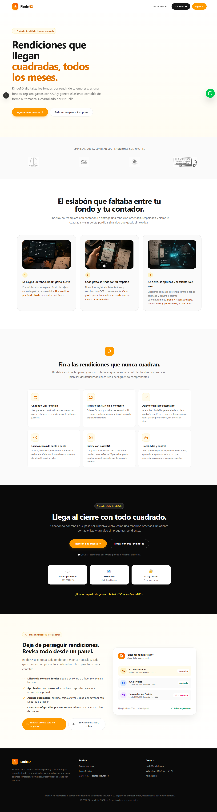
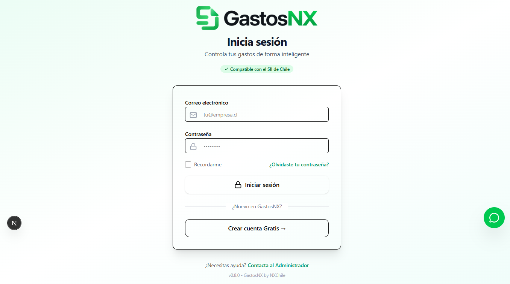
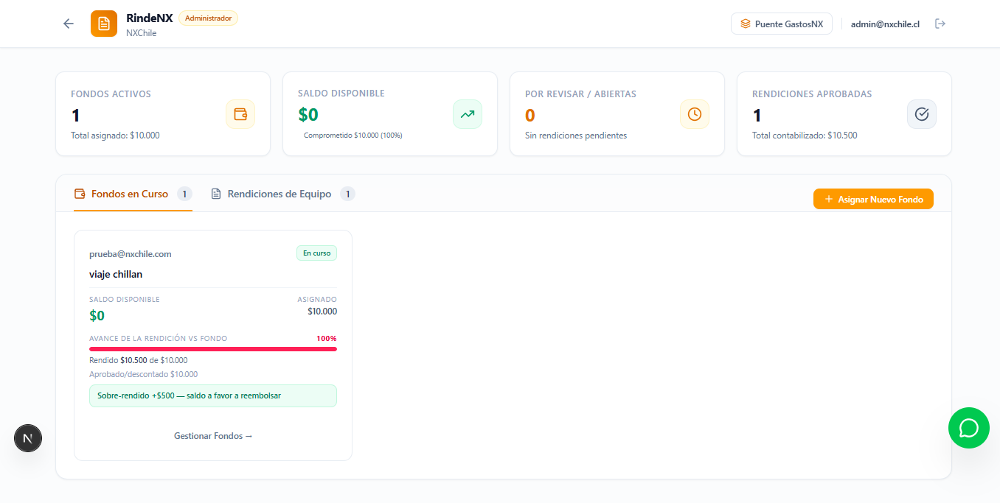
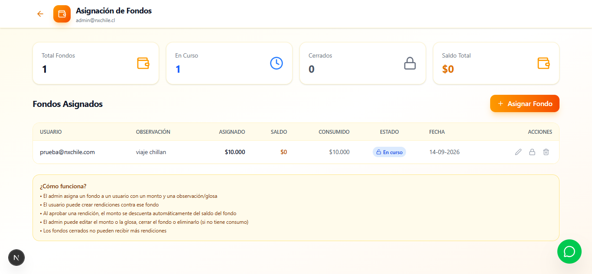
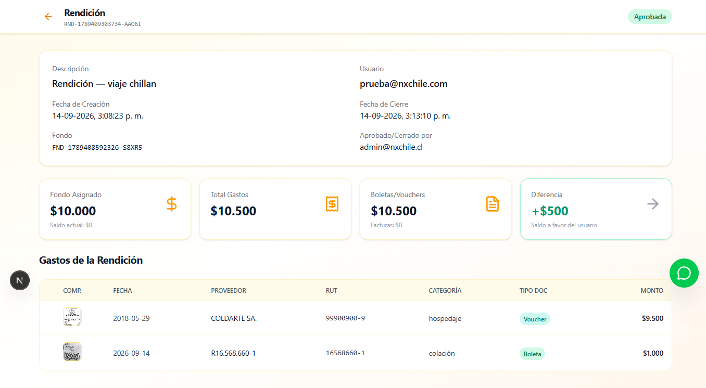
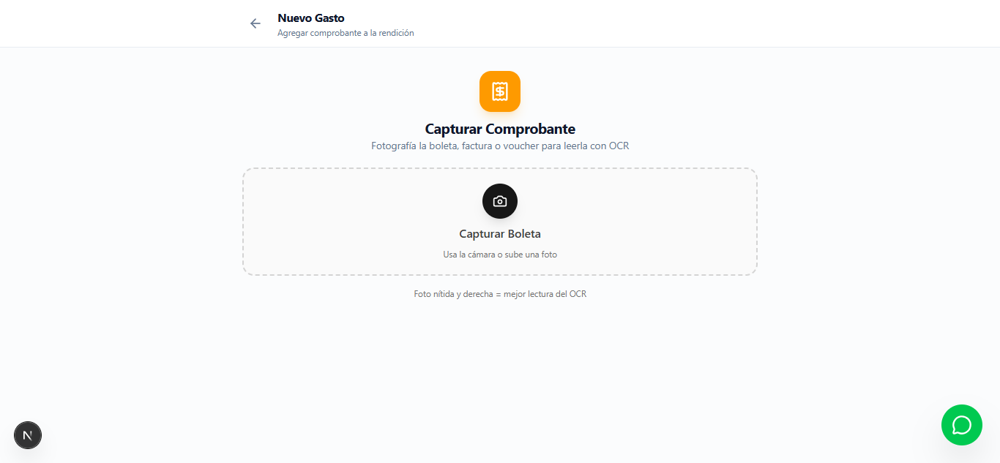
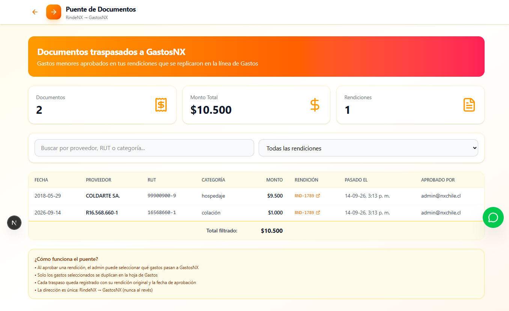

# Manual de Usuario rindeNX

> Guía operativa para usar rindeNX dentro de GastosNX. Este documento describe lo que puedes hacer con la herramienta, según lo comprobado en la versión actual. Donde el flujo aún requiere validación adicional, se indica claramente.

---

## Bienvenido a rindeNX

rindeNX es la parte de GastosNX dedicada al control de rendiciones de fondos. Te permite registrar los gastos vinculados a un fondo que te fue asignado, respaldarlos, revisarlos y seguir su estado hasta que se cierre.

No reemplaza la declaración de renta ni determina si un gasto es deducible. Su propósito es orden, respaldo y trazabilidad de la operación.

Funciona bajo el subdominio `rinde.nxchile.com` y está integrado con el resto de GastosNX a través del puente de documentos aprobados.

---

## 1. Antes de comenzar

### Conceptos básicos

- **Fondo**: monto asignado a tu usuario para cubrir gastos de una rendición.
- **Rendición**: registro que agrupa los gastos de un fondo. Puede tener varios estados a lo largo de su ciclo.
- **Gasto**: registro individual de una compra o comprobante vinculado a tu rendición.
- **Respaldo**: comprobante documental que acompaña al gasto (boleta, voucher, factura o sin comprobante).
- **Aprobación**: acción administrativa para validar la rendición y permitir su cierre o traspaso.
- **Rechazo**: devolución de la rendición para corrección.
- **Puente**: paso de los gastos aprobados hacia GastosNX. Solo aplica para ciertos tipos de documentos.
- **Asiento contable**: registro cuadrado generado para la rendición, con cuentas configuradas por la organización.

---

## 2. Ingreso al sistema

### Pantalla de inicio

La página pública muestra la propuesta de rindeNX: rendiciones cuadradas para fondos por rendir. Aquí puedes informar o ingresar al sistema.

### Acceso con usuario autorizado

Ingresa tu correo y contraseña en la pantalla de inicio de sesión. Después de ingresar con un usuario autorizado, el sistema te dirige al panel principal según tu rol. No se incluyen aquí credenciales de prueba.

---

## 3. Panel principal

Después de ingresar, llegas al panel de rindeNX. Aquí puedes ver:

- Un resumen general con cifras clave.
- Pestañas para consultar fondos y rendiciones.
- Indicación del consumo del fondo asignado.
- Estado de rendiciones en trámite o pendientes de acción.

Según tu rol, verás opciones distintas: administración de fondos y revisión de rendiciones, o solo consulta y registro de gastos propios.

---

## 4. Fondos

En esta sección puedes consultar los fondos asignados y, si tienes rol de administrador, gestionar la asignación a usuarios.

Confirmado:
- Lista de fondos disponibles.
- Formulario para asignar montos y observaciones.

> Lo que aún requiere validación completa en esta versión del manual: creación completa con guardado confirmado paso a paso, actualización de saldos y vinculación con nuevas rendiciones.

---

## 5. Rendiciones

La rendición es el registro que agrupa los gastos de tu fondo. Cada fondo puede tener una rendición activa que reutiliza el registro existente en lugar de crear múltiples.

Confirmado:
- Carga de la pantalla de detalle.
- Estructura de secciones según el rol.
- Existencia de estados y acciones diferenciadas entre administrador y usuario de rendición.

> Esta parte del flujo se encuentra pendiente de validación completa en esta versión del manual.

Es decir: los pasos completos de creación, transición de estados, aprobación paso a paso y cierre no han sido comprobados visualmente de principio a fin. Si operas con una rendición, usa la información confirmada y consulta con tu administrador los pasos que aún requieren revisión visual completa.

---

## 6. Registro de gastos

Esta pantalla permite agregar un gasto a tu rendición. Confirmado que carga correctamente cuando accedes desde la rendición correspondiente.

Confirmado:
- Pantalla disponible para registrar un nuevo gasto.
- Carga de la interfaz.

> Esta parte del flujo se encuentra pendiente de validación completa en esta versión del manual.

Lo que aún requiere comprobación visual completa: el comportamiento completo del registro, la incorporación de respaldos, la validación de que la rendición esté activa para recibir gastos y el funcionamiento de los mensajes de límite o sobre-rendición.

Recomendación operativa: antes de registrar, confirma con tu administrador o con la pantalla de detalle que tu rendición admite nuevos gastos.

---

## 7. Revisión, aprobación y rechazo

No se comprobó visualmente el flujo completo de aprobación o rechazo paso a paso en esta versión del manual.

Confirmado por evidencias de código y restricciones observadas:
- El administrador puede revisar y tomar decisiones sobre la rendición.
- El usuario de rendición no realiza estas acciones.
- La rendición debe estar en condición adecuada para recibir nuevas acciones.

> Esta parte del flujo se encuentra pendiente de validación completa en esta versión del manual.

---

## 8. Puente

 | 

El puente permite que los gastos aprobados pasen al sistema general de GastosNX.

Confirmado:
- Pantalla de puente carga correctamente.
- Restricción observada: el usuario de rendición puede acceder a la sección pero no realiza la selección de documentos para pasar; esa acción corresponde al administrador.

> Esta parte del flujo se encuentra pendiente de validación completa en esta versión del manual.

Lo que aún requiere comprobación visual completa: la selección manual de gastos, el filtro por tipo de documento aprobado y la confirmación del traspaso. Según la documentación interna, solo ciertos documentos pasan; otros quedan bloqueados. Consulta con tu administrador si tienes dudas sobre qué gastos pueden ser trasladados.

---

## 9. Asiento contable

Cada rendición puede generar su registro contable cuadrado. Confirmado que la pantalla de detalle muestra la estructura donde debe aparecer esta información.

Confirmado:
- Estructura de la pantalla con secciones organizadas.
- El código confirma que el registro es cuadrado y utiliza cuentas configuradas por la organización.

> Esta parte del flujo se encuentra pendiente de validación completa en esta versión del manual.

El despliegue completo de líneas separadas por tipo de documento y la confirmación visual de la cuadratura quedan para validación adicional.

---

## 10. Roles y permisos

### Administrador

- Accede a `/rinde` y a `/rinde/fondos`.
- Puede gestionar asignación de fondos.
- Puede revisar rendiciones y tomar acciones administrativas.
- Puede acceder al puente para seleccionar documentos aprobados.
- Puede consultar el asiento contable completo.

### Usuario de rendición

- Accede a `/rinde` tras iniciar sesión.
- Consulta su fondo y rendición asignada.
- Registra gastos cuando la rendición lo permite.
- Puede finalizar su rendición.
- No realiza aprobación ni selección para puente.
- No ve el asiento completo ni selecciona documentos para traspaso.

Confirmado visualmente: la restricción en puente fue comprobada (`09_rendicion_puente_restriction.png`). El usuario de rendición opera con limitaciones visibles.

---

## 11. Preguntas frecuentes

**¿Qué es rindeNX?**
Es la parte de GastosNX para controlar rendiciones de fondos: registrar gastos, respaldarlos, seguir su estado y prepararlos para cierre o traspaso.

**¿Quién debe usarlo?**
Quienes gestionan fondos asignados y sus rendiciones: administradores y usuarios de rendición autorizados.

**¿Cómo ingreso?**
A través de la pantalla de inicio de sesión. No necesitas configurar nada adicional.

**¿Qué hago si no veo mi rendición?**
Confirma con tu administrador que tienes un fondo asignado y que la rendición esté activa.

**¿Puedo eliminar un gasto registrado?**
El manual no confirma pasos de eliminación visuales. Consulta con tu administrador o tu área operativa.

**¿Qué pasa con los gastos rechazados?**
Quedan registrados para corrección. El flujo completo de rechazo paso a paso requiere validación visual adicional en esta versión.

---

## 12. Consideraciones importantes

- Usa datos de prueba o identificables (`PRUEBA`, `TEST`, `DEMO`) si creas registros de ejemplo.
- No eliminates información existente de la operación.
- Si tienes dudas sobre estados o restricciones, consulta con tu administrador antes de actuar.
- El puente y el asiento contable son funciones administrativas o de control; no son acciones que todo usuario de rendición debe realizar.
- Esta guía refleja lo comprobado en la versión evaluada. Si el sistema se actualiza, puede requerir actualización de esta sección.

---

## 13. Estado de documentación

| Funcionalidad | Estado | Observación |
|---|---|---|
| Landing | Confirmado | Pantalla pública comprobada |
| Ingreso al sistema | Confirmado | Login y redirección comprobados |
| Panel principal | Confirmado | Dashboard comprobado |
| Fondos | Confirmado | Lista y formulario comprobados |
| Rendiciones | Parcial | Carga comprobada; flujo completo pendiente |
| Registro de gastos | Parcial | Pantalla comprobada; comportamiento completo pendiente |
| Revisión y aprobación | Pendiente | No comprobado paso a paso en esta versión |
| Puente | Parcial | Carga y restricción comprobadas; flujo completo pendiente |
| Asiento contable | Parcial | Estructura comprobada; despliegue completo pendiente |

> Esta versión del manual documenta lo comprobado y señala claramente lo que aún requiere validación. No sustituye capacitación operativa para procedimientos que no han sido verificados visualmente de principio a fin.

---

*Manual de Usuario rindeNX — preparado para conversión futura a HTML sin reescritura de contenido. Estructura basada en secciones claras, referencias relativas a capturas reales y diferenciación explícita entre confirmado, parcial y pendiente.*
